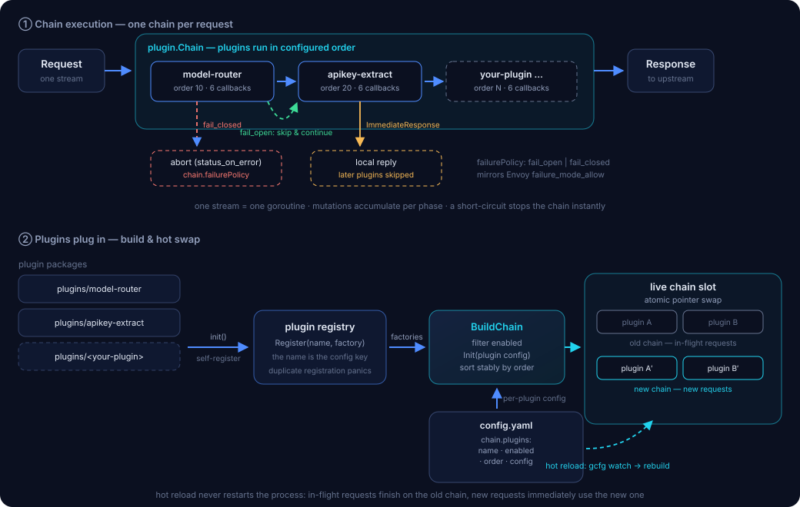

# ext-proc

**English** | [简体中文](README.zh-CN.md)

Move gateway plugins out of WASM — a filter-chain plugin framework built on [Envoy](https://www.envoyproxy.io)'s [ext_proc](https://www.envoyproxy.io/docs/envoy/latest/configuration/http/http_filters/ext_proc_filter) filter.

Every plugin is just a Go package behind a standard gRPC service: deploy and scale independently, crashes never take down Envoy. Generation-safe hot reload, per-plugin failure policy, TLS/mTLS, Prometheus metrics, W3C trace propagation, and two LLM-gateway plugins out of the box.

> **💡 Use it as a scaffold.** This repo is a ready-to-clone starting point for developing your own ext_proc filter: clone it, remove the two sample plugins (their packages under `internal/plugins/`, their imports in `main.go`, and their segments in `config.yaml` — or simply set `enabled: false`), then develop your business logic in `internal/plugins/<your-plugin>`. Everything a data-plane service needs — chain orchestration, hot reload, metrics, graceful shutdown, panic recovery — is handled by the framework. The two sample plugins double as working reference implementations: keep them, study them, or delete them. See [Write your own plugin](#write-your-own-plugin).

## Why leave WASM behind

WASM plugins live inside the Envoy process — memory, failures and operations are all coupled. ext_proc moves plugin logic into an ordinary process; the price is one gRPC round-trip per processing phase.

| Dimension | WASM plugin | ext-proc |
|---|---|---|
| Memory & tail latency | WASM VM rebuilds at a ~200MB threshold — the rebuild window drops headers and blocks workers; a cooldown turns it into a storm | **No VM: no rebuild window**; config hot-reload swaps the chain atomically |
| Failure domain | A plugin panic cuts the stream (`503 wasm_fail_stream`); FAIL_OPEN silently passes traffic | Process isolation: plugin panics are recovered per stream; a process crash does not take down Envoy. **Explicit fail-open / fail-closed**, with per-plugin rollback. |
| Language & debugging | TinyGo constraints; wasm logs are a black box | Any gRPC language; standard Kubernetes tooling — observable and debuggable |
| Operations | Embedded in the Envoy process, released with the gateway | Standalone service: HPA, PDB, graceful drain and canary releases come for free |
| Streaming | Chunked HttpBody callbacks; large bodies are fragile | Chunked / `FULL_DUPLEX_STREAMED` modes are supported by the SDK; the sample plugins use BUFFERED semantics and skip partial chunks |

## Architecture



**1. Request path.** A request enters Envoy, whose `ext_proc` HTTP filter opens one bidirectional gRPC stream per request. Envoy sends up to six phase messages (request headers/body/trailers, response headers/body/trailers); the SDK replies with mutations or an `ImmediateResponse` that short-circuits the upstream call. One stream is handled by one goroutine, and mutations are accumulated per phase.

**2. Inside ext-proc.** `RequestContext` owns the stream state (request metadata, shared KV, the parsed W3C `traceparent`). `RouteTable` is an immutable generation: for each enabled plugin it resolves the first matching `matchRule` (or the global config), then `Chain` runs the plugin instances in `order`. The chain enforces the per-plugin `failurePolicy`, snapshots/rolls back mutations on `fail_open`, recovers panics at the plugin boundary, and reports `plugin`/`phase` metrics. Plugins are immutable; `Close` is idempotent.

**3. Generation and operations.** Config reload builds and validates a complete next generation before an atomic swap. In-flight streams pin their generation; the retired one is closed after its last stream, so plugin-owned connections/caches are released without disturbing live traffic. A failed reload keeps the previous generation. The same binary supports a loopback sidecar or a cross-pod Deployment with TLS/mTLS + NetworkPolicy; `/metrics`, `/healthz` and `/readyz` cover observability and draining.

One stream per request · one goroutine per stream · an `ImmediateResponse` short-circuits the chain · two-layer fail-open / fail-closed.

## Core features

- **Chain orchestration** — plugins run in the configured `order`; the first short-circuit stops the rest. Plugins share nothing but request-scoped state.
- **Standard plugin API** — six phase callbacks + `BasePlugin` defaults + self-registration in `init()`: one package, five steps, zero coupling.
- **Hot reload** — GoFrame gcfg watches `config.yaml` and rebuilds the chain atomically; in-flight requests keep the old chain, and the retired generation is closed after its last stream. Zero restarts.
- **Two-layer failure policy** — chain-level `fail_open` / `fail_closed` mirrors Envoy's `failure_mode_allow`, and each plugin can override it (`plugins[].failurePolicy`): auth plugins fail-closed while routing helpers fail-open, in the same chain. `fail_open` skips are logged; panics and partial mutations are rolled back per plugin.
- **Observability** — Prometheus metrics (streams, phase errors, duration histograms with classic buckets, and per-plugin `plugin`/`phase` latency + failures), gRPC/HTTP health checks, and metadata-only structured slog logging. Raw headers and bodies are never logged. Metric catalog: [`docs/metrics.md`](docs/metrics.md). Grafana dashboard: [`manifest/deploy/grafana-dashboard.json`](manifest/deploy/grafana-dashboard.json).
- **Production engineering** — three-step graceful drain (unready → propagation delay → bounded stop); gRPC flow control delegated to Envoy backpressure; **panic recovery** — a plugin or processor panic only affects the current stream, is rolled back per policy, and is counted by `extproc_panic_recoveries_total`.

## Production surface

| Area | What this repository provides |
|---|---|
| Data path | One gRPC stream per request, six phase callbacks, BUFFERED/STREAMED guards, configurable gRPC message limits, bounded body handling |
| Failure semantics | Per-plugin `fail_open` / `fail_closed`, panic recovery at the plugin boundary, mutation + request-state rollback, `ImmediateResponse` for unconditional rejection |
| Lifecycle | Transactional config reload (build → validate → atomic swap), per-stream generation pinning, old generation `Close` after the last stream, idempotent plugin shutdown |
| Security | Header name/value validation, Envoy-protected header rejection, credential-free metadata logs, TLS/mTLS, certificate/CA hot reload, NetworkPolicy examples |
| Observability | Stream/phase/plugin Prometheus metrics, classic histograms (stream duration also native), W3C `traceparent` propagation, metadata-only logs, `/healthz` `/readyz`, gRPC health Watch, Grafana dashboard |
| Delivery | Vendored offline builds, multi-arch scratch image, version/commit labels, Docker healthcheck, CI (build/vet/race ×2), Envoy e2e and k6 load test |

## Operational endpoints

| Endpoint | Purpose |
|---|---|
| gRPC `:50051` | `envoy.service.ext_proc.v3.ExternalProcessor` |
| gRPC health | `grpc.health.v1.Health/Check` and `Watch`; flips to NOT_SERVING during drain |
| HTTP `:19090/metrics` | Prometheus metrics (default port; configurable) |
| HTTP `:19090/healthz` | Liveness; 200 while the process runs |
| HTTP `:19090/readyz` | Readiness; 503 after SIGTERM starts draining |
| `ext-proc --healthcheck` | Scratch-image/Docker healthcheck helper |

## Sample plugins

### `model-router` *(migrated from the higress model-router plugin)*

Extracts the model name from the request body and injects a routing header — the foundation for model routing and multi-provider gateways.

- **JSON / multipart**: on-demand extraction with gjson, no full parse; multipart form fields supported too
- **`provider/model` prefix split**: the provider goes into its own header; the body model name can be de-prefixed (`keepOriginalModelName`)
- **`higress/auto` routing**: regex rules match the last user message; falls back to `defaultModel`

### `apikey-extract`

Normalizes API keys scattered across sources into one target request header for downstream plugins and upstreams.

- **Ordered fallback sources**: `x-api-key` header → `Authorization: Bearer` → `apikey` query parameter
- **Leak prevention**: `stripSource` deletes the source header (query sources can't be removed by protocol)
- **Required mode**: `401` rejection when no source matches; the body is JSON-encoded to prevent injection

## Route-scoped configuration (matchRules)

Like higress wasmPlugin `matchRules` — but owned **per plugin**: each plugin carries its own rules, resolved independently per request (one plugin on a rule override while another stays global is the normal case). Rules are evaluated in order — **first match wins** — and unmatched requests use the plugin's global config:

```yaml
plugins:
- name: model-router
  order: 10
  config: { modelToHeader: x-higress-llm-model }   # global default
  matchRules:
  - domain: ["api.example.com"]
    pathPrefix: /v1/chat
    config: { modelToHeader: x-model-chat }        # deep-merged over the global config
  - domain: ["*.internal.corp"]
    disable: true                                  # plugin off for this domain
- name: apikey-extract
  order: 20
  matchRules:
  - pathPrefix: /internal/
    disable: true
```

- `domain` supports exact names, `*.wildcard`, or `*` (the port is stripped before matching); `pathPrefix` is a prefix match — a rule matches when **all** configured dimensions match.
- Rule `config` deep-merges over the plugin's global config; `disable: true` switches the plugin off for the matched routes (other plugins unaffected).
- Each plugin's variants are pre-built at config load (one instance per rule) and the whole table is swapped atomically on hot reload — in-flight requests finish on the old table, new requests immediately use the matched variants.

## Quick start

```shell
# 1. Build and run (dependencies vendored — offline builds work)
git clone https://github.com/JimDevil/ext-proc.git && cd ext-proc
make vendor && make build
./bin/ext-proc   # gRPC :50051 · Prometheus :19090/metrics
# or: make run
# EXT_PROC_CONFIG=/path/to/config.yaml overrides the config file path
```

Wire it into Envoy (the essential part — see also `manifest/envoyfilter-demo.yaml` for the Istio/Higress `EnvoyFilter` form):

```yaml
http_filters:
- name: envoy.filters.http.ext_proc
  typed_config:
    "@type": type.googleapis.com/envoy.extensions.filters.http.ext_proc.v3.ExternalProcessor
    stat_prefix: ext_proc
    grpc_service:
      envoy_grpc: { cluster_name: ext-proc-cluster }
    processing_mode:
      request_header_mode: SEND
      request_body_mode: BUFFERED      # plugins receive the complete JSON/multipart
      response_header_mode: SEND
      response_body_mode: NONE
    message_timeout: 2s
    failure_mode_allow: false          # auth/routing plugins want fail-closed
```

```shell
# 2. Send a request and watch the injected headers
curl -s http://localhost:8080/v1/chat/completions \
  -H "Content-Type: application/json" \
  -H "x-api-key: your-key" \
  -d '{"model":"glm-5.3","messages":[{}]}'

# Headers seen by the upstream (visible in echo services / access logs):
#   x-higress-llm-model: glm-5.3      <- injected by model-router
#   x-extracted-apikey:  your-key     <- injected by apikey-extract
```

### Docker

Multi-stage `Dockerfile`: static binary built offline from the vendored deps, scratch runtime with CA certs, non-root, and version/commit labels. Multi-arch ready (`TARGETARCH`-aware):

```shell
make image          # build for the local platform + smoke-run the container
make image-multi    # build & push linux/amd64 + linux/arm64 (needs buildx + registry login)
```

The scratch image also supports a healthcheck command for Docker/Kubernetes
exec probes:

```shell
/app/ext-proc --healthcheck   # GETs http://127.0.0.1:19090/healthz
```

### End-to-end and load tests

A compose stack runs Envoy → ext_proc → echo upstream:

```shell
make e2e          # start the stack, assert injected headers, stop
make loadtest     # k6 load test against the running stack (requires k6)
```

See [`test/e2e/README.md`](test/e2e/README.md) for details and thresholds.

## Deployment profiles

The same binary supports both layouts; only the listen address and security
boundary differ.

| | Same-Pod sidecar | Cross-Pod Deployment |
|---|---|---|
| `server.bindAddress` | `127.0.0.1` | `0.0.0.0` (behind NetworkPolicy) |
| Envoy cluster | `127.0.0.1:50051` (h2c) | `ext-proc.<ns>.svc:50051` |
| TLS | Not needed on loopback | Enable `server.tls`; add `clientCAFile` for mTLS |
| Scaling | With the gateway Pod | Independent replicas + PDB/HPA |
| Example | `manifest/deploy/sidecar/` | `manifest/deploy/deployment.yaml` |

```yaml
server:
  bindAddress: 127.0.0.1          # sidecar profile
  metricsBindAddress: 127.0.0.1
  maxRecvMsgSize: 16777216        # align with Envoy's buffered body limit
  maxSendMsgSize: 16777216
  tls:
    enabled: false                # cross-pod: true + certFile/keyFile/clientCAFile
    # reloadIntervalSeconds: 30   # poll certificate/CA files for rotation
```

For cross-pod, enable TLS/mTLS, mount the certificate Secret, and apply a
NetworkPolicy that only admits the gateway and monitoring namespaces. Details
and both manifests live in [`manifest/deploy/`](manifest/deploy/).

## Write your own plugin

Plugins have zero coupling to each other, so different people can develop different plugins in parallel:

1. **Create a package** `internal/plugins/<name>`; embed `plugin.BasePlugin` and override only the phases you need.
2. **Implement the interface** — the six phase callbacks on demand; `Init` parses your own config section and fills defaults.
3. **Self-register** — `plugin.Register` in `init()`, plus one anonymous import in `main.go`.
4. **Add a config segment** — `name/enabled/order/config` under `chain.plugins` in `config.yaml`. Omitting `enabled` means enabled; set `enabled: false` to switch a plugin off explicitly.
5. **Table-driven tests** — assert header/body operations with the `plugintest` mock Context; keep `make test` green.

```go
package myplugin

type MyPlugin struct {
	plugin.BasePlugin // override only the phases you need
}

func New() plugin.Plugin { return &MyPlugin{} }
func init()              { plugin.Register("my-plugin", New) }

func (m *MyPlugin) Name() string { return "my-plugin" }

func (m *MyPlugin) OnRequestHeaders(ctx plugin.Context, h extproc.AllHeaders) error {
	// Short-circuit with a local reply; returning nil continues the chain.
	if _, blocked := h.Get("x-block"); blocked {
		return ctx.CancelRequest(403, nil, "blocked by my-plugin")
	}
	return nil
}
```

```yaml
chain:
  failurePolicy: fail_closed
  plugins:
    - name: model-router
      enabled: true
      order: 10
      config: { modelToHeader: x-higress-llm-model }
    - name: my-plugin
      enabled: true
      order: 20
      config: { yourKey: yourValue }   # plugin-private config, parsed by the plugin itself
```

## Performance: ext_proc vs wasmPlugin

Measured end to end on a single-node k8s with a Higress 2.2.4 gateway and a streaming LLM-style SSE upstream: the same semantic work (extract `model` → inject header) run once as the official higress `model-router` **wasmPlugin** and once as this repo's 2-plugin **ext_proc** chain. 3 interleaved rounds at 16 concurrency, plus a 64-concurrency saturation probe. Full methodology, raw data and harness: [docs/benchmark.md](docs/benchmark.md) (`manifest/benchmark/`).

| TTFT (ms) | mean | p50 | p90 | p99 |
|---|---|---|---|---|
| baseline (no plugin) | 5.24 | 4.62 | 9.86 | 18.30 |
| wasmPlugin (in-process) | 4.93 | 4.06 | 9.25 | 16.28 |
| ext_proc (2-plugin chain) | 5.78 | 4.80 | 9.74 | 19.37 |

- **TTFT**: both runtimes stay within ~1ms of the no-plugin baseline at p50 — at real LLM TTFT scales (hundreds of ms and up) the plugin runtime is not a TTFT factor.
- **Throughput ceiling**: at 64-way concurrency the wasmPlugin holds baseline (−0.7% rps, TTFT p50 +1.6ms); the ext_proc chain gives back ~3% rps (TTFT p50 +8ms) for its per-phase gRPC round trips.
- **Where ext_proc time goes**: the plugin work itself is µs-scale (`extproc_phase_duration_seconds`: 7–21µs per phase); the measured cost is the hop mechanics, not the logic — and that hop buys process isolation, native Go tooling and independent deployment.

## Notes

- **Failure policy**: `fail_closed` returns a gRPC error; Envoy still makes the final call via `failure_mode_allow`. If a request must be rejected regardless of Envoy's policy (for example authentication), use `CancelRequest` to send an immediate local reply, as `apikey-extract` does in required mode.
- **Hot reload**: only the `chain` section is hot-reloadable. A new generation is fully built and validated before it is published; a failed rebuild keeps the previous chain and config. Changes to `app`, `logger` or `server` require a restart. The retired generation is closed after its last in-flight stream, so plugins may own connections/caches as long as `Close` releases them idempotently. Caveat: gcfg watches the file inode; Kubernetes ConfigMap updates via symlink rename may not fire a watch event, so restart the pod after a ConfigMap change or edit the mounted file in place.
- **Envoy-protected headers**: `:method`, `:authority`, `host` and `x-envoy-*` cannot be rewritten; the SDK rejects those mutations early with a clear error.
- **Content-Length**: the SDK leaves it to Envoy when a plugin mutates the body. `ReplaceBody` replaces the body bytes only; plugins should not write `content-length` themselves.
- **Large bodies**: `server.maxRecvMsgSize` / `maxSendMsgSize` must be at least as large as the bodies Envoy buffers. Under `BUFFERED` a single message carries the whole body; under `STREAMED` the sample plugins detect partial chunks and skip them instead of rewriting an incomplete document.
- **TLS rotation**: set `server.tls.reloadIntervalSeconds` (for example `30`) to poll the certificate/CA files; a failed reload keeps the previous material. `0` disables polling and requires a restart.
- **Tracing**: the SDK parses W3C `traceparent` and exposes `trace_id`/`span_id` in metadata logs and `plugin.Context.RequestInfo()`; no external tracing exporter is required.
- **Plugin context**: use `ctx.Context()` for downstream calls/cancellation, `ctx.RequestInfo()` for method/path/request_id/trace_id, and `ctx.ClearRouteCache()` after mutating a header that routing depends on.
- **Logging**: runtime logs are metadata-only (phase, request id, method, path, body length). Never enable raw body/header logging in production; `logger.level: debug` is intentionally not the sample default.
- **SDK**: the ext_proc server SDK lives in-tree at [`sdk/`](sdk/) (forked from [wrossmorrow/envoy-extproc-sdk-go](https://github.com/wrossmorrow/envoy-extproc-sdk-go), refactored and maintained here — see its README for the changes).

## Security

See [SECURITY.md](SECURITY.md) for the vulnerability disclosure process and the
deployment/security invariants.

## License

Apache-2.0
